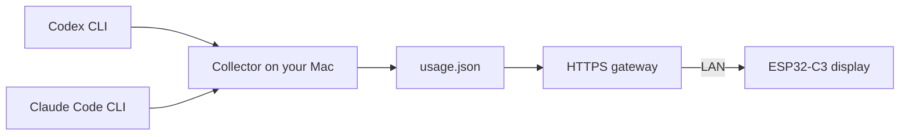

# DeskBuddy

DeskBuddy is a 3D-printed desktop robot with an ESP32-C3 and a 1.8-inch display. It shows how much of your Codex and Claude Code subscription limits you have used and when each limit resets. The screen shows the 5-hour and 7-day windows for both services.

[Hardware and wiring](#hardware-and-wiring) · [Print the enclosure](#print-the-v6-enclosure) · [Set up the gateway](#set-up-the-gateway) · [Flash the ESP32](#flash-and-provision-the-esp32) · [Troubleshooting](#troubleshooting)

## How it works



The collector uses the CLI sessions signed in on your Mac. It reads Codex every two minutes through `codex app-server` and Claude Code every five minutes through `claude -p /usage`. The ESP32 polls the gateway every 30 seconds by default and authenticates with its own device key. Your CLI credentials stay on the Mac.

The collector keeps the last successful values if a read fails. The gateway flags an existing reading as stale when its source is rate-limited or when it is older than three polling intervals. If a countdown reaches zero, the usage percentage stays at its last reported value until a fresh reading arrives.

## Hardware and wiring

- ESP32-C3 Super Mini with USB-C and a USB data cable.
- 1.8-inch ST7735 SPI TFT, 128 × 160 pixels. The v6 mount is sized around a 34.5 × 58 mm display PCB and an 18 × 22.52 mm ESP32-C3 PCB.
- Hookup wire and a 47–100 Ω series resistor for the backlight of the reference TFT module.
- A 2.4 GHz Wi-Fi network that lets the ESP32 reach the Mac on the local network.

| TFT pin | ESP32-C3 connection |
| --- | --- |
| VCC | 3V3 |
| GND | GND |
| SCK / SCL | GPIO4 |
| SDA / MOSI | GPIO6 |
| CS | GPIO7 |
| A0 / DC | GPIO3 |
| RESET / RST | GPIO1 |
| LED | GPIO5 through a 47–100 Ω resistor for sleep control, or 3V3 through the resistor for an always-on backlight |

On the red board marked `1.8 TFT SPI 128*160 V1.1`, `LED` is the backlight anode. Check the pin and resistor requirements if you use a different board. Disconnect USB power before wiring.

## Print the v6 enclosure

The [v6 STL folder](cad/v6/print/STL/) contains 27 meshes for a roughly 147 mm tall robot, including fit samples. Import the files in millimetres. Start with PLA, a 0.4 mm nozzle and 0.20 mm layers. Preview supports around overhangs and clear them from the sockets and TFT clips after printing.

### Test the fit first

| Files | What to check |
| --- | --- |
| `coupon_tft_1.stl` | The LCD clears the opening, the PCB holes slip over the locating pins, and both side clips latch. |
| `coupon_esp_1.stl` | The ESP32 slides into the rails, the USB-C connector clears the opening, and the front clips engage. |
| `coupon_back_peg_1.stl`, `coupon_back_socket_1.stl` | The upper rear-cover peg seats and releases by hand. Align the flat sides. |
| `gauge_horizontal_1.stl`, `gauge_vertical_1.stl`, `gauge_*_1.stl` peg samples | Compare the loose, nominal, and tight pegs in both socket orientations. The pegs have one, two, and three holes respectively. |

Press on the PCB near its supports when fitting the TFT. Check the fit with your own boards and printer before committing to the full enclosure.

### Import the assembly parts

For each row, import all listed files as **one object with multiple parts**. Keep their relative positions, then assign materials and move or rotate the object as a group. The numbered meshes in a multicolour group meet at the colour boundaries. Assign the same filament to every part of a group for a single-colour print.

| Object | STL files and reference colours | Copies |
| --- | --- | ---: |
| Head | `head_1` mint shell, `head_2` black face, `head_3`–`head_5` white eyes and smile | 1 |
| Torso | `torso_1` mint front, `torso_2` black TFT bezel | 1 |
| Rear cover | `back_1` mint cover and ESP32 mount | 1 |
| Arms | `arm_left_1` and `arm_left_2` together, `arm_right_1` and `arm_right_2` together. Mint arms and black hands. | 1 per side |
| Feet | `foot_left_1` and `foot_left_2` together, `foot_right_1` and `foot_right_2` together. Mint soles and black shoes. | 1 per side |
| Ears and antenna | `ear_1` and `antenna_1` as separate black objects | 2 ears, 1 antenna |

### Assemble

1. Test the wiring and display on the bench before closing the enclosure.
2. Fit the arms, feet, head, ears and antenna, aligning the flat sides of the press-fit joints.
3. Insert the TFT from the back of the torso. Align its mounting holes with the two locating pins and press on the PCB until both clips catch.
4. Slide the ESP32 into the rear cover with its header pins facing down, away from the chip and USB-C side of the board. Check that the USB cable reaches the connector.
5. Route the wires clear of the pegs and close the cover. To open it again, pull evenly from the recess along the bottom edge.

## Set up the gateway

The following setup uses macOS, Python 3, OpenSSL, and Docker with the Compose plugin. For live readings, install Codex CLI and Claude Code and sign in to each on the Mac that will run the collector. Python uses only the standard library.

### 1. Clone and generate local credentials

```bash
git clone https://github.com/Franek1703/deskBuddy.git
cd deskBuddy
GATEWAY_IP=192.168.1.50  # Replace with your Mac's LAN IP.
./deploy/init_secrets.sh "$GATEWAY_IP"
```

This creates a local CA, a server certificate valid for that IP, and an ESP32 bearer key in `deploy/local/secrets/`. If the gateway IP changes, run the script again with the new address and provision the new address on the ESP32. Keep the original CA key so the existing CA remains valid.

### 2. Start the collector or load demo data

For live readings, leave the collector running in a terminal:

```bash
(cd gateway && python3 -m deskbuddy_gateway.collector --data-dir ../deploy/local/data)
```

For a test without CLI accounts, leave the collector stopped and generate sample data:

```bash
python3 tools/write_scenario.py normal
```

### 3. Start the gateway

From the repository root, in a second terminal:

```bash
docker compose -f deploy/compose.yaml up -d --build
curl --fail --cacert deploy/local/secrets/ca.pem https://127.0.0.1:8443/healthz
```

The gateway reads the snapshot from a read-only volume. A successful health response confirms HTTPS is working. A numeric `snapshot_age_s` confirms the gateway found a snapshot.

<details>
<summary>Run the HTTPS gateway directly with Python</summary>

From the repository root:

```bash
(
  cd gateway
  python3 -m deskbuddy_gateway.server \
    --data-dir ../deploy/local/data \
    --keys-file ../deploy/local/secrets/device_keys.txt \
    --cert ../deploy/local/secrets/server.pem \
    --key ../deploy/local/secrets/server.key
)
```

</details>

<details>
<summary>Keep the collector running with launchd</summary>

Stop the foreground collector before installing the per-user agent:

```bash
./deploy/install_collector_launchd.sh "$(command -v codex)" "$(command -v claude)"
tail -f deploy/local/collector.log
```

Use `--codex-bin` or `--claude-cmd` with the foreground collector if your CLIs need custom paths or if Claude Code runs on another host over SSH.

</details>

## Flash and provision the ESP32

Install Arduino CLI and the ESP32 core and libraries. These commands use the ESP32 core version used by the project.

```bash
ESP32_INDEX=https://espressif.github.io/arduino-esp32/package_esp32_index.json
arduino-cli core update-index --additional-urls "$ESP32_INDEX"
arduino-cli core install esp32:esp32@3.3.11 --additional-urls "$ESP32_INDEX"
arduino-cli lib install "Adafruit ST7735 and ST7789 Library" "Adafruit GFX Library" ArduinoJson
```

Plug in the ESP32. Use `arduino-cli board list` to find its USB serial port and replace the example values below.

```bash
PORT=/dev/cu.usbmodem1101
FQBN=esp32:esp32:esp32c3:CDCOnBoot=cdc,PartitionScheme=no_fs
arduino-cli compile --fqbn "$FQBN" firmware/deskbuddy
arduino-cli upload --fqbn "$FQBN" --port "$PORT" firmware/deskbuddy

GATEWAY_IP=192.168.1.50  # Use the IP passed to init_secrets.sh.
python3 tools/provision.py --port "$PORT" --ssid "My 2.4 GHz Wi-Fi" \
  --gw-host "$GATEWAY_IP" --set bl_pin=5 --set bl_on=1
python3 tools/serial_log.py --port "$PORT" --seconds 60 --send STATUS
```

The provisioning tool prompts for your Wi-Fi password. It saves the network settings, gateway address, device key and CA in the ESP32's nonvolatile storage. For the 3V3 backlight wiring, omit the two backlight settings. To switch the gateway later, run provisioning again with the new host and the corresponding secrets directory. Reflashing is unnecessary.

## Sleep schedule

DeskBuddy stops polling, disconnects Wi-Fi, and blanks the display during its sleep window. GPIO5 backlight wiring lets it turn off the backlight as well. The gateway sends the schedule and the ESP32 saves it locally and evaluates it once its clock is verified. On wake, the firmware gives the first fetch up to 20 seconds before relighting the display.

| Gateway environment variable | Default |
| --- | --- |
| `DESKBUDDY_SLEEP_WEEKDAYS` | `22:00-07:00` |
| `DESKBUDDY_SLEEP_WEEKEND` | `22:00-07:00` |
| `DESKBUDDY_TZ` | `CET-1CEST,M3.5.0,M10.5.0/3` (Europe/Warsaw, including DST) |

Set schedules to `HH:MM-HH:MM` or `off`. The device selects the rule for the current local day. A Saturday rule of `23:30-09:00` applies both before 09:00 and from 23:30 onward on Saturday. For Docker, set the variables in [deploy/compose.yaml](deploy/compose.yaml) and re-run `docker compose -f deploy/compose.yaml up -d`.

Test sleep over USB with `python3 tools/serial_log.py --seconds 40 --send "SLEEP_NOW 20" --send STATUS`.

## Troubleshooting

| Symptom | What to check |
| --- | --- |
| Dark or garbled display | Verify backlight power and SPI wiring. Send `TEST` for a colour pattern and `APPLY` to return to the usage screen. The defaults are `tft_tab=2` (black tab) and `tft_mhz=8`. Other panels may need a different tab, rotation, colour order, inversion, or offsets. |
| `NO WIFI` | Confirm the SSID is available on 2.4 GHz. The suffix `d201` means no AP found, `d202` means authentication failed, and `d15` means the handshake timed out. Use `SCAN` after the connection attempt because scanning interrupts it. If authentication remains unreliable, `SET wifi_tx 13` is one setting to try. The default is 8.5 dBm. |
| Wi-Fi connected, HTTPS fails | Check that the LAN IP matches the certificate, the ESP32 has the corresponding CA, and the Mac accepts connections on port 8443. Check clock status over USB if TLS reports that the certificate is outside its validity period. |
| Usage is stale or missing | Check the collector logs, CLI sign-ins and `/healthz`. Write the `normal` scenario with the collector stopped to verify the rest of the path. |

USB serial runs at 115200 baud. Start with `HELP`, `STATUS`, and `FETCH`. The gateway's `seq` and `served` log values match the device's `RENDER` log, so you can trace a particular response.

## API and development

- `GET /healthz` returns the current snapshot sequence and age without authentication.
- `GET /v1/usage` requires `Authorization: Bearer <device key>`. It returns the current time, sleep schedule, and Codex and Claude usage windows. Each window contains the percentage used and reset timing. Each service reports `fresh`, `stale`, or `missing`.
- The [example snapshot](examples/usage.example.json) shows the file passed from the collector to the gateway. The [response builder](gateway/deskbuddy_gateway/payload.py) defines the device-facing JSON.

| Path | Contents |
| --- | --- |
| [cad/v6/print/STL/](cad/v6/print/STL/) | Printable enclosure and fit samples |
| [firmware/deskbuddy/](firmware/deskbuddy/) | ESP32 Arduino firmware |
| [gateway/](gateway/) | Python collector, HTTPS server and tests |
| [deploy/](deploy/) | Certificates, Docker Compose and launchd setup |
| [tools/](tools/) | USB provisioning, serial logs and demo data |

Run the gateway and sleep schedule tests from the repository root:

```bash
(cd gateway && python3 -m unittest discover -s tests -t . -v)
clang++ -std=c++17 -I firmware/deskbuddy firmware/tests/test_sleep_schedule.cpp \
  -o /tmp/deskbuddy-test-sleep
/tmp/deskbuddy-test-sleep
```

With the collector stopped, use `python3 tools/write_scenario.py` with one of `normal`, `zero`, `full`, `missing-window`, `missing-service`, `stale`, `expired`, or `rate-limited` to test display states without live accounts.

## Contributing

Include your board and display model when reporting a hardware issue. For enclosure fit reports, include the STL filename, material, layer height, and the fit sample you used. For firmware or gateway bugs, include reproduction steps and relevant logs with credentials removed. [GitHub issues](https://github.com/Franek1703/deskBuddy/issues)

## License

Licensing for the software and enclosure files is pending.
